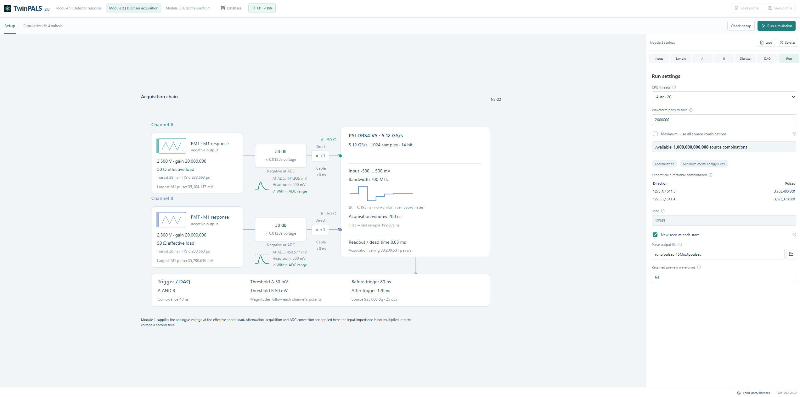
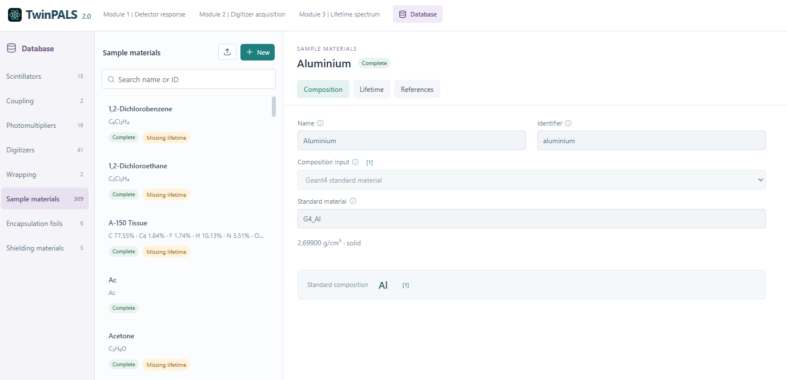

# TwinPALS 2.0

**Cite this software** · Danny Petschke, *TwinPALS 2.0*, version 2.0.2 (development). When publishing results, please also cite Dominik Boras’s 2024 doctoral dissertation on the PALS digital twin. [Software citation (CITATION.cff)](CITATION.cff) · [Dissertation (DOI)](https://doi.org/10.25972/OPUS-37663)

TwinPALS simulates positron annihilation lifetime spectroscopy (PALS) on Windows x64. Set up a detector, acquire digitized pulse pairs and see how timing, filters and event selection affect the lifetime spectrum. The desktop and MCP server share the same simulation engines and component catalogue.

[](docs/screenshots/detector-transport.png)

| Digitizer setup | Waveform acquisition | Lifetime analysis |
| :--- | :--- | :--- |
| [](docs/screenshots/acquisition-chain.png) | [](docs/screenshots/waveform-acquisition.png) | [](docs/screenshots/lifetime-analysis.png) |

## Run the desktop

Download a Windows x64 build from [Releases](https://github.com/dpscience/TwinPALS2.0-public/releases). Run **TwinPALS-…-setup.exe** for a Start menu entry and automatic reuse of your catalogue on updates. For a portable copy, extract the **entire ZIP** to a writable folder and open **TwinPALS.exe**. Both include the scientific runtime. The tray icon reopens the workbench.

## Run a study with an MCP client

**Codex, Claude and GitHub Copilot** can run the three modules locally, compare analysis settings on the same recorded pulses, and save a report linked to the underlying runs.

In PowerShell, open the program folder (by default `%LOCALAPPDATA%\Programs\TwinPALS 2.0` for Setup) or the extracted portable folder and print the configuration for your client.

```powershell
.\TwinPALS-MCP.exe --print-config claude-desktop
```

Replace `claude-desktop` with `codex`, `claude-code`, `copilot-cli` or `vscode` as appropriate. Add the printed entry to the client's MCP configuration, reconnect and ask it to call **capabilities**. The client starts the local server. Choose **Open study observer** in the tray to follow its work. [Client configuration and study examples](docs/mcp/README.md)

### Connect TwinPALS to Codex

1. Open **Status and paths** from the TwinPALS tray icon to find the program folder. In that folder, run this in PowerShell.

   ```powershell
   .\TwinPALS-MCP.exe --print-config codex
   ```

   Your command prints the paths for your installation. The example below uses the screenshot's program folder and a custom workspace selected with `--data-dir D:\TwinPALS\Data`.

   ```toml
   [mcp_servers.twinpals]
   command = "C:\\Tools\\TwinPALS\\TwinPALS-MCP.exe"
   args = ["--data-dir", "D:\\TwinPALS\\Data"]
   ```

2. In Codex, open **Plugins → MCPs → Add**, choose a local **STDIO** server and name it `twinpals`. Enter the executable path under **Command to launch**. Under **Arguments**, add `--data-dir` and the data folder as two separate entries. TOML escapes each backslash as `\\`. In the form, enter ordinary Windows paths such as `D:\TwinPALS\Data`, without quotes. Leave the environment and working directory fields empty.
3. Save, enable the server and open a new chat. Ask **“Call TwinPALS capabilities and show my study workspace.”** The returned data directory identifies the catalogue and studies this connection uses. [Codex MCP documentation](https://developers.openai.com/codex/mcp/)

| Command and arguments · example paths | Enabled server in Codex |
| :--- | :--- |
| [](docs/screenshots/codex-mcp-command.png) | [](docs/screenshots/codex-mcp-servers.png) |

### Try a zero-lifetime timing study

This study measures the simulated instrument response function (IRF). Each cell of a 9 × 9 grid uses the same waveform pairs. The row sets the constant-fraction (CF) level in A and the column sets it in B. Paste this prompt into your connected client.

```text
Find the CF levels for A and B that minimize the simulated coincidence IRF FWHM.

Use Na-22 and record the detector, digitizer and source timing settings. In Module 2
use exactly one discrete lifetime component: tau = 0 ps, intensity = 100%.
Keep detector timing spread, electronic noise and digitizer jitter at their
configured values. Generate one pulse stream for the entire scan. Record its seed.

In Module 3, vary CF independently in A and B from 10% to 90% in steps of 10%.
Run all 81 combinations on that stream. Keep the PHS windows, filters, cable
correction, histogram range and bin width fixed throughout.

Use the merged ideal/intended same-decay contribution for the prompt peak.
Measure its full width at half maximum in ps using one method for all settings.
State how you determine the baseline and interpolate both half-height crossings.
Record the peak counts and accepted fraction. Flag unresolved widths and acquire
more statistics if needed. Treat statistical ties as ties.

Produce a 9 x 9 FWHM heatmap and a table. Give the best independent CF levels
(A, B) and the best shared level (A = B). Cross-check the best settings on
a new independent seed. Save a Markdown report with uncertainties and run IDs.
```

## Component catalogue

| Photomultiplier tube | Sample material |
| :--- | :--- |
| [](docs/screenshots/photomultiplier-catalogue.png) | [](docs/screenshots/sample-material-catalogue.png) |

<!-- factory-catalogue:start -->
The factory catalogue contains **396 entries**. Expand a family to see every supplied material, tube or acquisition preset.

| Included | Catalogue family | Entries | Use |
| :---: | :--- | ---: | :--- |
| ✓ | Scintillators | 15 | Light generation and optical transport |
| ✓ | Optical coupling | 2 | Interface between crystal and PMT window |
| ✓ | Photomultiplier tubes | 16 | Photocathode and anode response |
| ✓ | Digitizer presets | 41 | Sampling and voltage-range configurations |
| ✓ | Reflector wrappings | 2 | Crystal surface and reflectance |
| ✓ | Sample materials | 309 | Source sandwich and positron lifetimes |
| ✓ | Encapsulation foils | 6 | Source encapsulation and foil lifetimes |
| ✓ | Shielding materials | 5 | Particle transport through shielding |

<details>
<summary>Scintillators (15)</summary>

| Entry | Model light yield (photons/MeV) |
| :--- | ---: |
| BaF₂ | 11500 |
| BC-418 | 10200 |
| BC-422Q 0.5% | 2900 |
| BC-422Q 1% | 1700 |
| BC-422Q 2% | 770 |
| BC-422Q 3% | 610 |
| BC-422Q 5% | 460 |
| CeBr₃ | 60000 |
| EJ-232 | 8400 |
| EJ-232Q 0.5% | 2900 |
| EJ-232Q 1% | 1700 |
| EJ-232Q 2% | 770 |
| EJ-232Q 3% | 610 |
| EJ-232Q 5% | 460 |
| LYSO:Ce | 33200 |

</details>

<details>
<summary>Optical coupling (2)</summary>

| Entry | Density (g/cm³) |
| :--- | ---: |
| Air | 0.00120479 |
| EJ-550 silicone grease | 1.06 |

</details>

<details>
<summary>Photomultiplier tubes (16)</summary>

| Entry | Model rise time (ns) |
| :--- | ---: |
| ET Enterprises 9214B | 3 |
| Hamamatsu R11265U-100 | 1.3 |
| Hamamatsu R11265U-20 | 1.3 |
| Hamamatsu R11265U-200 | 1.3 |
| Hamamatsu R11265U-300 | 1.3 |
| Hamamatsu R1450 | 1.8 |
| Hamamatsu R1828-01 | 1.3 |
| Hamamatsu R2059 | 1.3 |
| Hamamatsu R2083 | 0.8 |
| Hamamatsu R329-02 | 2.6 |
| Hamamatsu R3377 | 0.8 |
| Hamamatsu R5320 | 0.7 |
| Hamamatsu R7400U-06 | 0.78 |
| Hamamatsu R9800 | 1 |
| Photonis XP2020 | 1.5 |
| Photonis XP2020Q | 1.5 |

</details>

<details>
<summary>Digitizer presets (41)</summary>

| Entry | ADC resolution (bits) |
| :--- | ---: |
| Acqiris DP240-002 · 0.5 GS/s · ±100 mV | 8 |
| Acqiris DP240-002 · 0.5 GS/s · ±1000 mV | 8 |
| Acqiris DP240-002 · 0.5 GS/s · ±25 mV | 8 |
| Acqiris DP240-002 · 0.5 GS/s · ±250 mV | 8 |
| Acqiris DP240-002 · 0.5 GS/s · ±2500 mV | 8 |
| Acqiris DP240-002 · 0.5 GS/s · ±50 mV | 8 |
| Acqiris DP240-002 · 0.5 GS/s · ±500 mV | 8 |
| Acqiris DP240-003 · 1 GS/s · ±100 mV | 8 |
| Acqiris DP240-003 · 1 GS/s · ±1000 mV | 8 |
| Acqiris DP240-003 · 1 GS/s · ±25 mV | 8 |
| Acqiris DP240-003 · 1 GS/s · ±250 mV | 8 |
| Acqiris DP240-003 · 1 GS/s · ±2500 mV | 8 |
| Acqiris DP240-003 · 1 GS/s · ±50 mV | 8 |
| Acqiris DP240-003 · 1 GS/s · ±500 mV | 8 |
| Acqiris SA220P · 1 GS/s · ±1250 mV | 14 |
| Acqiris SA220P · 1 GS/s · ±250 mV | 14 |
| Acqiris SA220P · 2 GS/s · ±1250 mV | 14 |
| Acqiris SA220P · 2 GS/s · ±250 mV | 14 |
| LeCroy WavePro 960 · 8 GS/s · ±500 mV | 8 |
| PSI DRS4 V5 · 1.00721 GS/s | 14 |
| PSI DRS4 V5 · 1.98194 GS/s | 14 |
| PSI DRS4 V5 · 5.12 GS/s | 14 |
| Teledyne LeCroy WavePro 254HD · 20 GS/s · ±200 mV | 12 |
| Teledyne LeCroy WavePro 254HD · 20 GS/s · ±400 mV | 12 |
| Teledyne LeCroy WavePro 404HD · 20 GS/s · ±200 mV | 12 |
| Teledyne LeCroy WavePro 404HD · 20 GS/s · ±400 mV | 12 |
| Teledyne LeCroy WavePro 604HD · 20 GS/s · ±200 mV | 12 |
| Teledyne LeCroy WavePro 604HD · 20 GS/s · ±400 mV | 12 |
| Teledyne LeCroy WavePro 804HD · 20 GS/s · ±200 mV | 12 |
| Teledyne LeCroy WavePro 804HD · 20 GS/s · ±400 mV | 12 |
| Teledyne LeCroy WaveRunner 9254 · 20 GS/s · ±200 mV | 8 |
| Teledyne LeCroy WaveRunner 9254 · 20 GS/s · ±400 mV | 8 |
| Teledyne LeCroy WaveRunner 9254M · 40 GS/s · ±200 mV | 8 |
| Teledyne LeCroy WaveRunner 9254M · 40 GS/s · ±400 mV | 8 |
| Teledyne LeCroy WaveRunner 9404 · 20 GS/s · ±200 mV | 8 |
| Teledyne LeCroy WaveRunner 9404 · 20 GS/s · ±400 mV | 8 |
| Teledyne LeCroy WaveRunner 9404M · 40 GS/s · ±200 mV | 8 |
| Teledyne LeCroy WaveRunner 9404M · 40 GS/s · ±400 mV | 8 |
| Teledyne SP Devices ADQ14DC-2A · 0.5 GS/s · ±250 mV | 14 |
| Teledyne SP Devices ADQ14DC-2C · 1 GS/s · ±250 mV | 14 |
| Teledyne SP Devices ADQ14DC-2X · 2 GS/s · ±500 mV | 14 |

</details>

<details>
<summary>Reflector wrappings (2)</summary>

| Entry |
| :--- |
| PTFE powder — reflectance model |
| PTFE — measured LUT |

</details>

<details>
<summary>Sample materials (309)</summary>

87 of 309 entries include positron-lifetime components. A dash indicates that this entry supplies composition only.

| Entry | Lifetime data |
| :--- | ---: |
| 1,2-Dichlorobenzene | — |
| 1,2-Dichloroethane | — |
| A-150 Tissue | — |
| Ac | ✓ |
| Acetone | — |
| Acetylene | — |
| Adenine | — |
| Adipose Tissue Icrp | — |
| Air | — |
| Alanine | — |
| Aluminium | ✓ |
| Aluminum Oxide | — |
| Am | ✓ |
| Amber | — |
| Ammonia | — |
| Aniline | — |
| Anthracene | — |
| Ar | ✓ |
| As | ✓ |
| At | — |
| B | — |
| B-100 Bone | — |
| Ba | ✓ |
| Bakelite | — |
| Barium Fluoride | — |
| Barium Sulfate | — |
| Benzene | — |
| Beryllium | ✓ |
| Beryllium Oxide | — |
| Bgo | — |
| Bismuth | ✓ |
| Bk | ✓ |
| Blood Icrp | — |
| Bone Compact Icru | — |
| Bone Cortical Icrp | — |
| Boron Carbide | — |
| Boron Oxide | — |
| Br | ✓ |
| Brain Icrp | — |
| Brass | — |
| Bronze | — |
| Butane | — |
| C | ✓ |
| C-552 | — |
| Ca | ✓ |
| Cadmium | ✓ |
| Cadmium Telluride | — |
| Cadmium Tungstate | — |
| Calcium Carbonate | — |
| Calcium Fluoride | — |
| Calcium Oxide | — |
| Calcium Sulfate | — |
| Calcium Tungstate | — |
| Carbon Dioxide | — |
| Carbon Tetrachloride | — |
| Ce | ✓ |
| Cellulose Butyrate | — |
| Cellulose Cellophane | — |
| Cellulose Nitrate | — |
| Ceric Sulfate | — |
| Cesium Fluoride | — |
| Cesium Iodide | — |
| Cf | — |
| Chlorobenzene | — |
| Chloroform | — |
| Chromium | ✓ |
| Cl | ✓ |
| Cm | ✓ |
| Cobalt | ✓ |
| Concrete | — |
| Copper | ✓ |
| Cr39 | — |
| Cs | ✓ |
| Cyclohexane | — |
| Cytosine | — |
| Dacron | — |
| Deoxyribose | — |
| Dichlorodiethyl Ether | — |
| Diethyl Ether | — |
| Dimethyl Sulfoxide | — |
| Dna Adenine | — |
| Dna Cytosine | — |
| Dna Deoxyribose | — |
| Dna Guanine | — |
| Dna Phosphate | — |
| Dna Thymine | — |
| Dna Uracil | — |
| Dy | ✓ |
| Er | ✓ |
| Ethane | — |
| Ethyl Alcohol | — |
| Ethyl Cellulose | — |
| Ethylene | — |
| Eu | ✓ |
| Eye Lens Icrp | — |
| F | — |
| Ferric Oxide | — |
| Ferroboride | — |
| Ferrous Oxide | — |
| Ferrous Sulfate | — |
| Fr | — |
| Freon-12 | — |
| Freon-12B2 | — |
| Freon-13 | — |
| Freon-13B1 | — |
| Freon-13I1 | — |
| Gadolinium Oxysulfide | — |
| Galactic | — |
| Gallium | ✓ |
| Gallium Arsenide | — |
| Gd | ✓ |
| Ge | ✓ |
| Gel Photo Emulsion | — |
| Glass Lead | — |
| Glass Plate | — |
| Glutamine | — |
| Glycerol | — |
| Gold | ✓ |
| Graphite | — |
| Graphite Porous | — |
| Guanine | — |
| Gypsum | — |
| H | — |
| Hafnium | ✓ |
| He | — |
| Hg | ✓ |
| Ho | ✓ |
| I | ✓ |
| Indium | ✓ |
| Ir | ✓ |
| Iron | ✓ |
| K | ✓ |
| Kapton | — |
| Kevlar | — |
| Kr | ✓ |
| La | ✓ |
| Lanthanum Oxybromide | — |
| Lanthanum Oxysulfide | — |
| Lar | — |
| Lbr | — |
| Lead | ✓ |
| Lead Oxide | — |
| Lh2 | — |
| Li | ✓ |
| Lithium Amide | — |
| Lithium Carbonate | — |
| Lithium Fluoride | — |
| Lithium Hydride | — |
| Lithium Iodide | — |
| Lithium Oxide | — |
| Lithium Tetraborate | — |
| Lkr | — |
| Ln2 | — |
| Lo2 | — |
| Lpropane | — |
| Lu | ✓ |
| Lucite | — |
| Lung Icrp | — |
| Lxe | — |
| M3 Wax | — |
| Magnesium | ✓ |
| Magnesium Carbonate | — |
| Magnesium Fluoride | — |
| Magnesium Oxide | — |
| Magnesium Tetraborate | — |
| Manganese | ✓ |
| Mercuric Iodide | — |
| Methane | — |
| Methanol | — |
| Mix D Wax | — |
| Molybdenum | ✓ |
| Ms20 Tissue | — |
| Muscle Skeletal Icrp | — |
| Muscle Striated Icru | — |
| Muscle With Sucrose | — |
| Muscle Without Sucrose | — |
| Mylar | — |
| N | — |
| N,N-Dimethyl Formamide | — |
| N-Butyl Alcohol | — |
| N-Heptane | — |
| N-Hexane | — |
| N-Pentane | — |
| N-Propyl Alcohol | — |
| Na | ✓ |
| Naphthalene | — |
| Nd | ✓ |
| Ne | ✓ |
| Neoprene | — |
| Nickel | ✓ |
| Niobium | ✓ |
| Nitrobenzene | — |
| Nitrous Oxide | — |
| Np | ✓ |
| Nylon-11 Rilsan | — |
| Nylon-6-10 | — |
| Nylon-6-6 | — |
| Nylon-8062 | — |
| O | — |
| Octadecanol | — |
| Octane | — |
| Os | ✓ |
| P | ✓ |
| Pa | ✓ |
| Palladium | ✓ |
| Paraffin | — |
| Pbwo4 | — |
| Phosphoric Acid | — |
| Photo Emulsion | — |
| Plastic Sc Vinyltoluene | — |
| Platinum | ✓ |
| Plexiglass | — |
| Plutonium Dioxide | — |
| Pm | ✓ |
| Po | ✓ |
| Polyacrylonitrile | — |
| Polycarbonate | — |
| Polychlorostyrene | — |
| Polyethylene | — |
| Polyoxymethylene | — |
| Polypropylene | — |
| Polystyrene | — |
| Polytrifluorochloroethylene | — |
| Polyvinyl Acetate | — |
| Polyvinyl Alcohol | — |
| Polyvinyl Butyral | — |
| Polyvinyl Chloride | — |
| Polyvinyl Pyrrolidone | — |
| Polyvinylidene Chloride | — |
| Polyvinylidene Fluoride | — |
| Potassium Iodide | — |
| Potassium Oxide | — |
| Pr | ✓ |
| Propane | — |
| Pu | ✓ |
| Pyrex Glass | — |
| Pyridine | — |
| Ra | ✓ |
| Rb | ✓ |
| Re | ✓ |
| Rh | ✓ |
| Rn | — |
| Ru | ✓ |
| Rubber Butyl | — |
| Rubber Natural | — |
| Rubber Neoprene | — |
| S | — |
| Sb | ✓ |
| Sc | ✓ |
| Se | ✓ |
| Si | ✓ |
| Silicon Dioxide | — |
| Silver | ✓ |
| Silver Bromide | — |
| Silver Chloride | — |
| Silver Halides | — |
| Silver Iodide | — |
| Skin Icrp | — |
| Sm | ✓ |
| Sodium Carbonate | — |
| Sodium Iodide | — |
| Sodium Monoxide | — |
| Sodium Nitrate | — |
| Sr | ✓ |
| Stainless-Steel | — |
| Stilbene | — |
| Sucrose | — |
| Tantalum | ✓ |
| Tb | ✓ |
| Tc | ✓ |
| Te | ✓ |
| Teflon | — |
| Terphenyl | — |
| Testis Icrp | — |
| Tetrachloroethylene | — |
| Th | ✓ |
| Thallium Chloride | — |
| Thymine | — |
| Tin | ✓ |
| Tissue Soft Icrp | — |
| Tissue Soft Icru-4 | — |
| Tissue-Methane | — |
| Tissue-Propane | — |
| Titanium | ✓ |
| Titanium Dioxide | — |
| Tl | ✓ |
| Tm | ✓ |
| Toluene | — |
| Trichloroethylene | — |
| Triethyl Phosphate | — |
| Tungsten | ✓ |
| Tungsten Hexafluoride | — |
| U | ✓ |
| Uracil | — |
| Uranium Dicarbide | — |
| Uranium Monocarbide | — |
| Uranium Oxide | — |
| Urea | — |
| Valine | — |
| Vanadium | ✓ |
| Viton | — |
| Water | — |
| Water Vapor | — |
| Xe | ✓ |
| Xylene | — |
| Y | ✓ |
| Yb | ✓ |
| Zinc | ✓ |
| Zirconium | ✓ |

</details>

<details>
<summary>Encapsulation foils (6)</summary>

6 of 6 entries include positron-lifetime components. A dash indicates that this entry supplies composition only.

| Entry | Lifetime data |
| :--- | ---: |
| Aluminium | ✓ |
| Gold | ✓ |
| Kapton | ✓ |
| Lead | ✓ |
| Nickel | ✓ |
| Silver | ✓ |

</details>

<details>
<summary>Shielding materials (5)</summary>

| Entry | Density (g/cm³) |
| :--- | ---: |
| Aluminium | 2.699 |
| Gold | 19.32 |
| Lead | 11.35 |
| Nickel | 8.902 |
| Silver | 10.5 |

</details>
<!-- factory-catalogue:end -->

## Build from source

On Windows x64 with Python 3.12, Node.js/npm, CMake and Visual Studio 2022 C++ tools, run this from the repository root.

```powershell
.\scripts\build-workbench.ps1
.\Start-TwinPALS.cmd
```

Both factory tables are included. The source build fetches the pinned Geant4 SDK and physics data once and caches them. The portable application already includes its runtime and datasets. [Build steps, tests and portable packaging](docs/BUILD.md)

| Directory | Start here |
| --- | --- |
| `backend/` | Desktop launcher, local API, catalogue and module processing |
| `backend/mcp_server/` | MCP tools, persistent studies and the observer service |
| `frontend/src/` | React workbench, plots and observer |
| `native/` | Geant4 worker, pulse processing libraries and Windows tray |
| `seed/` and `third_party/geant4/` | Factory catalogue, material definitions and Geant4 dependency manifest |
| `tests/` and `frontend/tests/` | Python and frontend checks |

Original TwinPALS code is MIT-licensed. Catalogue entries record their sources. The bundled G4EMLOW data are for non-commercial use within Geant4. This product includes software developed by Members of the Geant4 Collaboration (http://cern.ch/geant4). [Notices](NOTICE.md) · [Scientific basis and citation](CITATION.cff)
