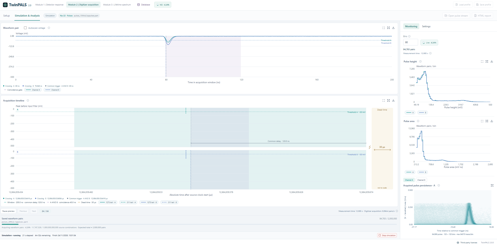
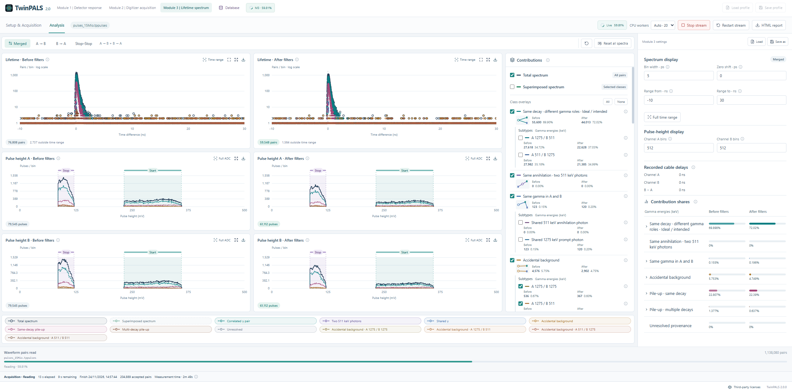
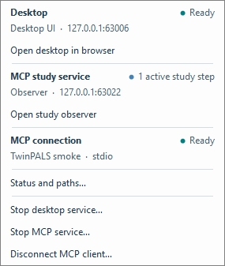
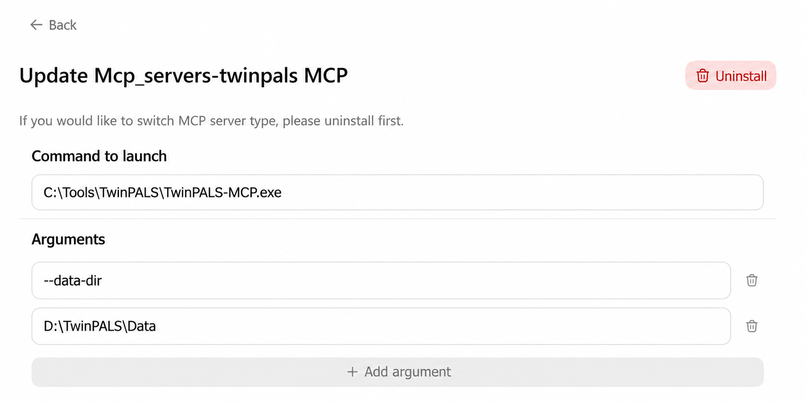
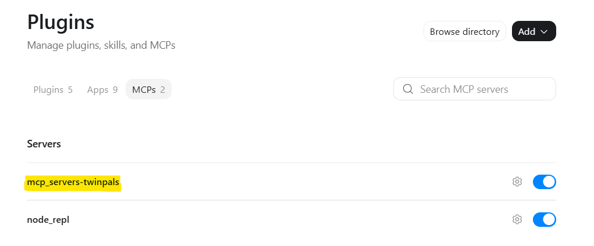
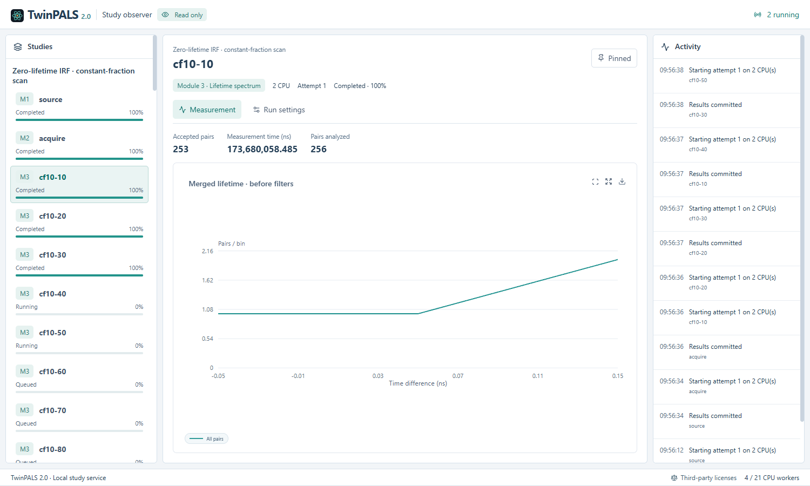

# TwinPALS 2.0

TwinPALS is a **digital twin of a positron annihilation lifetime spectrometer**. Build a virtual counterpart of your detector setup and follow a coincidence from gamma emission through the two detectors to its entry in the lifetime spectrum. You can study how much of a peak or tail comes from the intended start–stop pairs, scattered photons, overlapping pulses or accidental coincidences, and how much useful signal survives a change in your timing or selection settings.

**Cite this software.** Danny Petschke, *TwinPALS 2.0*, version 2.0.2. When publishing results, please also cite Dominik Boras’s 2024 doctoral dissertation on the PALS digital twin. [Software citation (CITATION.cff)](CITATION.cff) · [Boras dissertation (DOI)](https://doi.org/10.25972/OPUS-37663)

TwinPALS is organized into **three modules**, each modelling one stage of a measurement.

1. **Detector response** simulates how gamma rays from the source produce light in the detectors and electrical signals at the photomultipliers.
2. **Waveform acquisition** uses the source activity to simulate when decays occur, places the detector signals on that timeline and records digitized pulse pairs when the trigger fires.
3. **Lifetime analysis** measures the time difference between the two pulses, builds the lifetime spectrum and shows which types of events contribute to each peak or tail.

[Follow a measurement](#from-gamma-emission-to-a-lifetime-spectrum) · [Desktop setup](#open-twinpals-on-windows) · [AI-assisted studies](#run-a-study-with-an-ai-agent) · [Component catalogue](#component-catalogue) · [Download for Windows](https://github.com/dpscience/TwinPALS2.0-public/releases) · [Build from source](#build-from-source)

[](docs/screenshots/detector-transport.png)

*A simulated Na-22 event in Module 1. The detector view shows the particle tracks, and the anode plot shows the resulting electrical signal.*

## From gamma emission to a lifetime spectrum

A PALS measurement uses the delay between a start and a stop signal to study how long positrons survive in a sample. In a Na-22 setup, the prompt gamma provides the start and an annihilation gamma provides the stop. In the measured spectrum, that delay also reflects the detector response, electronics, pulse selection and background. TwinPALS models the chain in three stages so you can change one stage and see what it contributes.

### Module 1 · Detector response

Choose the isotope, sample and encapsulation, detector geometry, scintillators, optical interfaces and photomultiplier tubes (PMTs). Geant4 follows particle transport, energy deposition and light production. The output records the photoelectron arrivals and their origins for the two channels. The transport view at the top of this page shows how a simulated event reaches the anode. TwinPALS supports Na-22 and the correlated Co-60 cascade. [Detector-response method](docs/mcp/knowledge/detector-response.md)

### Module 2 · Waveform acquisition

Choose the **source activity in becquerels** to set the mean number of decays per second. Module 2 samples the decay times and places the Module 1 detector responses on that timeline. For Na-22, the selected positron-lifetime distribution sets the delay between the prompt gamma and the annihilation photons. At higher activity, signals from separate decays are more likely to overlap or fall inside the same coincidence window. The electronics and trigger settings then determine which A/B waveforms the digitizer records. You can save those pairs and replay them in Module 3. [Acquisition method](docs/mcp/knowledge/acquisition.md)

[](docs/screenshots/acquisition-chain.png)

*The acquisition setup defines which pulses the two channels can record together.*

[](docs/screenshots/waveform-acquisition.png)

*Inspect the resulting sampled pulses before choosing the timing and energy cuts.*

### Module 3 · Lifetime analysis

Measure pulse heights and constant-fraction crossing times on the saved waveforms. Apply the start and stop windows to build a lifetime spectrum from the measured time differences. TwinPALS uses each pair’s simulated history to group events by their physical origin. The list below gives just three examples from the many **event classes and their subtypes** that you can inspect in a Na-22 spectrum.

- **Intended coincidences.** The start detector records the prompt gamma and the stop detector records a 511 keV annihilation photon from the same decay.
- **One gamma in both detectors.** A gamma scatters in one detector and deposits energy in the other, producing a pulse in each channel. Within this class, separate subtypes show whether the shared photon was the 1275 keV prompt gamma or a 511 keV annihilation photon.
- **Accidental coincidences.** The start and stop signals come from different decays but fall within the same coincidence window.

Replay the same waveforms with a tighter pulse-height window to see how much accidental background it removes and how many intended pairs it costs.

[](docs/screenshots/lifetime-analysis.png)

## Two ways to use TwinPALS

Use the **desktop workbench** when you want to build a detector, inspect an individual pulse or try a cut yourself. Use an **AI agent** when you want to repeat a measurement across many settings and compare the results. Both use the same component catalogue and run the same three modules on your PC.

| Mode | How a measurement runs |
| --- | --- |
| **Desktop** | You choose the setup in the workbench → TwinPALS runs the modules → you inspect waveforms and spectra in the workbench. |
| **AI-assisted** | You describe a study in chat → the agent submits it through the Model Context Protocol (MCP) → TwinPALS runs the modules → you follow progress in the study observer and review the agent’s report. |

## Open TwinPALS on Windows

To open the workbench, download either Windows x64 package from the [release page](https://github.com/dpscience/TwinPALS2.0-public/releases). TwinPALS starts on your PC and opens its controls in your default browser.

| Distribution | First launch | Where your data go by default |
| --- | --- | --- |
| **Windows installer** | Run the release file ending in **-setup.exe**. Complete Setup, then open **TwinPALS 2.0** from the Start menu. | `%LOCALAPPDATA%\TwinPALS\Data`. Later installs reuse your catalogue, settings and study workspace. |
| **Portable ZIP** | Extract the **entire ZIP** to a writable folder. Open that folder and double-click **TwinPALS.exe**. Keep its companion files and folders together. | The `data` folder beside the executable. |

Both downloads include the scientific runtime, Geant4 data and desktop interface. When the browser opens, start in **Module 1** to set up the source and the two detectors. If you close the browser tab, click the TwinPALS icon in the Windows notification area (near the clock, sometimes under the hidden-icons arrow) and choose **Open desktop in browser**.

### The Windows tray

The tray gives you one place to find the desktop, the study service and any connected MCP clients. **Status and paths** identifies the installation and workspace. With the study service running, **Open study observer** opens the read-only view of agent work. Closing a browser tab leaves the underlying service running. The menu also lets you disconnect a client or stop a service.

[](docs/screenshots/windows-tray.png)

## Run a study with an AI agent

Suppose you want to know which timing settings give the narrowest prompt peak. Ask an assistant such as Codex, Claude or GitHub Copilot to replay one pulse stream at different constant-fraction levels. Through its MCP connection, the agent can look up your detector settings, submit each combination to TwinPALS, compare the resulting spectra and write a report with the run IDs behind its conclusions.

### Connect TwinPALS to Codex

1. Open the folder containing **TwinPALS-MCP.exe**. In File Explorer, type `powershell` in the address bar and press Enter. Run the following command to print the configuration for this copy.

   ~~~powershell
   .\TwinPALS-MCP.exe --print-config codex
   ~~~

2. In Codex, open the **MCP server settings**, add a local **STDIO** server named `twinpals` and enter the executable and arguments printed above. Each argument gets its own field. Alternatively, copy the printed TOML section into your Codex configuration.
3. Save and enable the connection, start a new chat and ask **“Call TwinPALS capabilities and show me the study workspace.”** Check the returned data directory before submitting a study.

<details>
<summary>See the Codex settings and the enabled server</summary>

[](docs/screenshots/codex-mcp-command.png)

[](docs/screenshots/codex-mcp-servers.png)

</details>

**Setup guides** · [Codex, including a TOML example](docs/mcp/CLIENTS.md#codex) · [Claude Desktop](docs/mcp/CLIENTS.md#claude-desktop) · [Claude Code](docs/mcp/CLIENTS.md#claude-code) · [GitHub Copilot CLI](docs/mcp/CLIENTS.md#github-copilot-cli) · [GitHub Copilot in VS Code](docs/mcp/CLIENTS.md#github-copilot-in-vs-code)

### What the study observer shows

The **study observer** lets you inspect what TwinPALS is computing while the agent works. For instance, when the agent says it is testing a new timing setting, you can see which run it submitted, check the actual setting and inspect the spectrum as soon as it is available. Open **Open study observer** from the tray when the MCP study service is running.

The left column lists the study steps and their progress. Select a step to inspect its measurements, plots or recorded settings in the centre. The activity feed on the right shows which runs started and when TwinPALS saved their results. The view is read-only, so you can explore the results or close the tab while the study continues. [Study tools, saved results and recovery](docs/mcp/README.md)

[](docs/screenshots/observer-cf-study.png)

*The timing scan below, photographed during a small pilot with 256 simulated pulse pairs. The selected run used 10% CF on both channels. Two other settings were running. This view illustrates how to follow the calculation. The pilot count is too small to select a best setting from this plot.*

### Try a zero-lifetime timing study

This study measures the simulated instrument response function (IRF). Each cell of a 9 × 9 grid uses the same waveform pairs. The row sets the constant-fraction (CF) level in A and the column sets it in B. Paste this prompt into your connected client.

```text
Find the CF levels for A and B that minimize the simulated coincidence IRF FWHM.

Use Na-22 and record the detector, digitizer and source timing settings. In Module 2
use exactly one discrete lifetime component: tau = 0 ps, intensity = 100%.
Keep detector timing spread, electronic noise and digitizer jitter at their
configured values. Generate one pulse stream for the entire scan. Record its seed.

In Module 3, vary CF independently in A and B from 10% to 90% in steps of 10%.
Run all 81 combinations on that stream. Keep the PHS windows, filters, cable
correction, histogram range and bin width fixed throughout.

Use the merged ideal/intended same-decay contribution for the prompt peak.
Measure its full width at half maximum in ps using one method for all settings.
State how you determine the baseline and interpolate both half-height crossings.
Record the peak counts and accepted fraction. Flag unresolved widths and acquire
more statistics if needed. Treat statistical ties as ties.

Produce a 9 x 9 FWHM heatmap and a table. Give the best independent CF levels
(A, B) and the best shared level (A = B). Cross-check the best settings on
a new independent seed. Save a Markdown report with uncertainties and run IDs.
```

## Component catalogue

Build a setup by selecting the parts you would choose at the bench. Each selection brings its stored properties into the model. For example, **BC-418** supplies a light yield of **10,200 photons/MeV** and a **1.4 ns** scintillation decay. A **Hamamatsu R329-02** supplies its photocathode response, gain curve and timing, including **1.1 ns FWHM** transit-time spread. A **PSI DRS4 V5** preset at **5.12 GS/s** selects a 1,024-sample record and a ±500 mV input range.

<!-- factory-catalogue:start -->
The factory catalogue contains **396 entries** across eight families.

| Family | Entries | What you select |
| --- | ---: | --- |
| [Scintillators](docs/COMPONENTS.md#scintillators) | 15 | Light yield, emission spectrum and decay components |
| [Optical coupling](docs/COMPONENTS.md#optical-coupling) | 2 | Optical properties between crystal and PMT window |
| [Photomultiplier tubes](docs/COMPONENTS.md#photomultiplier-tubes) | 16 | Photocathode response, gain and timing |
| [Digitizer presets](docs/COMPONENTS.md#digitizer-presets) | 41 | Sampling, ADC range and electronic response |
| [Reflector wrappings](docs/COMPONENTS.md#reflector-wrappings) | 2 | Surface finish and reflection model |
| [Sample materials](docs/COMPONENTS.md#sample-materials) | 309 | Sample composition, density and available lifetime references |
| [Encapsulation foils](docs/COMPONENTS.md#encapsulation-foils) | 6 | Source foil composition and lifetime references |
| [Shielding materials](docs/COMPONENTS.md#shielding-materials) | 5 | Composition and density for gamma transport |
<!-- factory-catalogue:end -->

The **[complete component catalogue](docs/COMPONENTS.md)** lists every factory entry with comparable properties and units. Open **Database** in the workbench to inspect curves, reference conditions and model assumptions, edit a record, or import and export your own catalogue. Lifetime references are available for a subset of samples and for all six encapsulation foils.

[](docs/screenshots/photomultiplier-catalogue.png)

*PMT records describe the optical entrance, sensitive area and electrical response.*

[](docs/screenshots/sample-material-catalogue.png)

*Sample records connect the material used for transport with the available positron-lifetime references.*

## Build from source

Build from source to inspect or change the simulation engines and workbench. On Windows x64 with Python 3.12, Node.js/npm, CMake and Visual Studio 2022 C++ tools, run the following commands from the repository root.

```powershell
.\scripts\build-workbench.ps1
.\Start-TwinPALS.cmd
```

Both factory tables are included. The source build fetches the pinned Geant4 SDK and physics data once and caches them. The portable application already includes its runtime and datasets. [Build steps, tests and portable packaging](docs/BUILD.md)

| Directory | Start here |
| --- | --- |
| `backend/` | Desktop launcher, local API, catalogue and module processing |
| `backend/mcp_server/` | MCP tools, persistent studies and the observer service |
| `frontend/src/` | React workbench, plots and observer |
| `native/` | Geant4 worker, pulse processing libraries and Windows tray |
| `seed/` and `third_party/geant4/` | Factory catalogue, material definitions and Geant4 dependency manifest |
| `tests/` and `frontend/tests/` | Python and frontend checks |

Original TwinPALS code is MIT-licensed. Catalogue entries record their sources. The bundled G4EMLOW data are for non-commercial use within Geant4. This product includes software developed by Members of the Geant4 Collaboration (http://cern.ch/geant4). [Notices](NOTICE.md) · [Scientific basis and citation](CITATION.cff)
