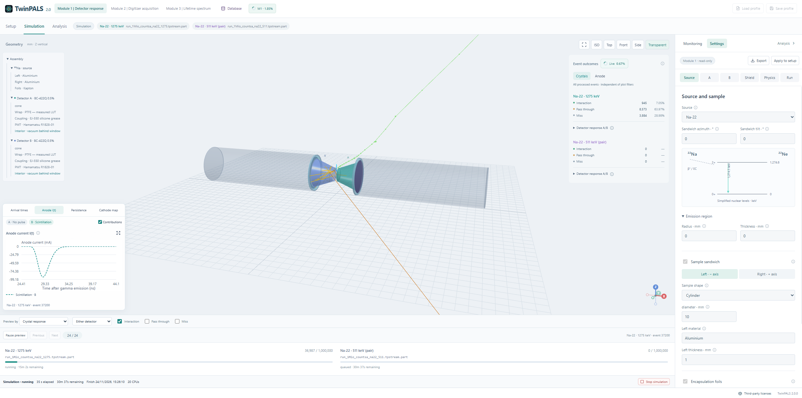
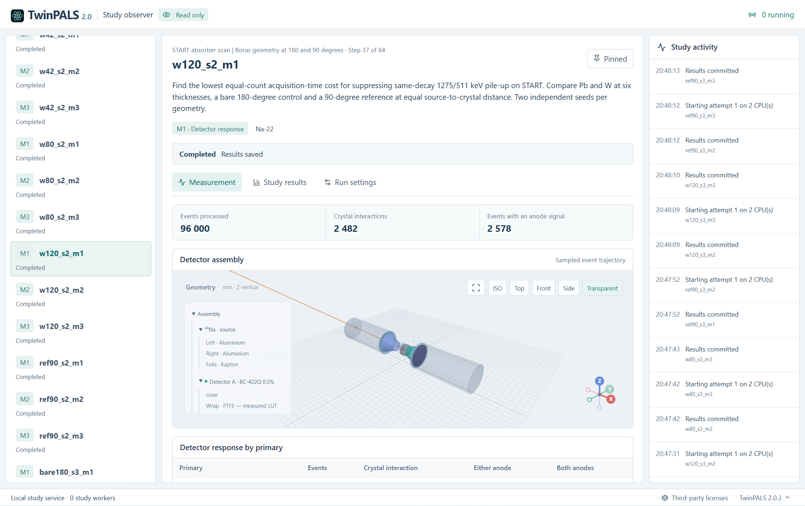
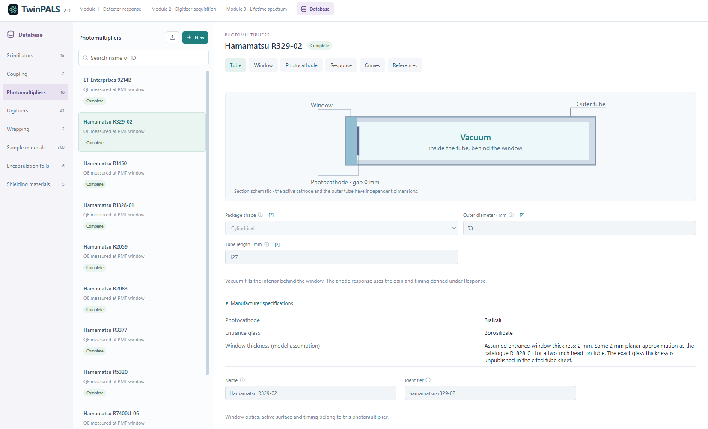

# TwinPALS 2.0

TwinPALS is a **digital twin of a positron annihilation lifetime spectrometer**. Build a virtual counterpart of your detector setup and follow a coincidence from gamma emission through the two detectors to its entry in the lifetime spectrum. You can study how much of a peak or tail comes from the intended start–stop pairs, scattered photons, overlapping pulses or accidental coincidences, and how much useful signal survives a change in your timing or selection settings.

[**Explore the TwinPALS website**](https://dpscience.github.io/TwinPALS2.0-public/) to follow the animated detector signal, browse the component catalogue and see how TwinPALS MCP runs a shielding study from a single prompt.

**Cite this software.** Danny Petschke, *TwinPALS 2.0*, version 2.0.3. When publishing results, please also cite Dominik Boras’s 2024 doctoral dissertation on the PALS digital twin. [Software citation (CITATION.cff)](CITATION.cff) · [Boras dissertation (DOI)](https://doi.org/10.25972/OPUS-37663)

TwinPALS is organized into **three modules**, each modelling one stage of a measurement.

1. **Detector response** simulates how gamma rays from the source produce light in the detectors and electrical signals at the photomultipliers.
2. **Waveform acquisition** uses the source activity to simulate when decays occur, places the detector signals on that timeline and records digitized pulse pairs when the trigger fires.
3. **Lifetime analysis** measures the time difference between the two pulses, builds the lifetime spectrum and shows which types of events contribute to each peak or tail.

[Follow a measurement](#from-gamma-emission-to-a-lifetime-spectrum) · [TwinPALS Desktop](#open-twinpals-on-windows) · [TwinPALS MCP](#run-a-study-with-an-ai-agent) · [Component catalogue](#component-catalogue) · [Download for Windows](https://github.com/dpscience/TwinPALS2.0-public/releases) · [Build from source](#build-from-source)

[](docs/screenshots/detector-transport.png)

*A simulated Na-22 event in Module 1. The detector view shows the particle tracks, and the anode plot shows the resulting electrical signal.*

## From gamma emission to a lifetime spectrum

A PALS measurement uses the delay between a start and a stop signal to study how long positrons survive in a sample. In a Na-22 setup, the prompt gamma provides the start and an annihilation gamma provides the stop. In the measured spectrum, that delay also reflects the detector response, electronics, pulse selection and background. TwinPALS models the chain in three stages so you can change one stage and see what it contributes.

### Module 1 · Detector response

Choose the isotope, sample and encapsulation, detector geometry, scintillators, optical interfaces and photomultiplier tubes (PMTs). Geant4 follows particle transport, energy deposition and light production. The output records the photoelectron arrivals and their origins for the two channels. The transport view at the top of this page shows how a simulated event reaches the anode. TwinPALS supports Na-22 and the correlated Co-60 cascade. [Detector-response method](docs/mcp/knowledge/detector-response.md)

### Module 2 · Waveform acquisition

Choose the **source activity in becquerels** to set the mean number of decays per second. Module 2 samples the decay times and places the Module 1 detector responses on that timeline. For Na-22, the selected positron-lifetime distribution sets the delay between the prompt gamma and the annihilation photons. At higher activity, signals from separate decays are more likely to overlap or fall inside the same coincidence window. The electronics and trigger settings then determine which A/B waveforms the digitizer records. You can save those pairs and replay them in Module 3. [Acquisition method](docs/mcp/knowledge/acquisition.md)

[](docs/screenshots/acquisition-chain.png)

*The acquisition setup defines which pulses the two channels can record together.*

[](docs/screenshots/waveform-acquisition.png)

*Inspect the resulting sampled pulses before choosing the timing and energy cuts.*

### Module 3 · Lifetime analysis

Measure pulse heights and constant-fraction crossing times on the saved waveforms. Apply the start and stop windows to build a lifetime spectrum from the measured time differences. TwinPALS uses each pair’s simulated history to group events by their physical origin. The list below gives just three examples from the many **event classes and their subtypes** that you can inspect in a Na-22 spectrum.

- **Intended coincidences.** The start detector records the prompt gamma and the stop detector records a 511 keV annihilation photon from the same decay.
- **One gamma in both detectors.** A gamma scatters in one detector and deposits energy in the other, producing a pulse in each channel. Within this class, separate subtypes show whether the shared photon was the 1275 keV prompt gamma or a 511 keV annihilation photon.
- **Accidental coincidences.** The start and stop signals come from different decays but fall within the same coincidence window.

Replay the same waveforms with a tighter pulse-height window to see how much accidental background it removes and how many intended pairs it costs.

[](docs/screenshots/lifetime-analysis.png)

## Two ways to use TwinPALS

TwinPALS Desktop and TwinPALS MCP run the same three simulation modules on your PC and use the same component catalogue. Choose how you want to control the measurement.

| Mode | How you use it |
| --- | --- |
| **TwinPALS Desktop** | Build the detector interactively, inspect an individual pulse and adjust a filter to see which events enter the lifetime spectrum. |
| **TwinPALS MCP** | Describe a study to an AI agent. Through the Model Context Protocol (MCP), the agent can configure runs, schedule independent measurements in parallel and compare the resulting spectra. |

## Open TwinPALS on Windows

To open TwinPALS Desktop, download either Windows x64 package from the [release page](https://github.com/dpscience/TwinPALS2.0-public/releases). TwinPALS starts on your PC and opens its controls in your default browser.

| Distribution | First launch | Where your data go by default |
| --- | --- | --- |
| **Windows installer** | Run the release file ending in **-setup.exe**. Complete Setup, then open **TwinPALS 2.0** from the Start menu. | `%LOCALAPPDATA%\TwinPALS\Data`. Later installs reuse your catalogue, settings and study workspace. |
| **Portable ZIP** | Extract the **entire ZIP** to a writable folder. Open that folder and double-click **TwinPALS.exe**. Keep its companion files and folders together. | The `data` folder beside the executable. |

Both downloads include the scientific runtime, Geant4 data and TwinPALS Desktop. When the browser opens, start in **Module 1** to set up the source and the two detectors. If you close the browser tab, click the TwinPALS icon in the Windows notification area (near the clock, sometimes under the hidden-icons arrow) and choose **Open desktop in browser**.

### The Windows tray

The tray gives you one place to find TwinPALS Desktop, the study service and any connected MCP clients. **Status and paths** identifies the installation and workspace. With the study service running, **Open study observer** opens the read-only view of agent work. Closing a browser tab leaves the underlying service running. The menu also lets you disconnect a client or stop a service.

[](docs/screenshots/windows-tray.png)

## Run a study with an AI agent

Connect an AI client such as Codex, Claude or GitHub Copilot to TwinPALS MCP. The agent can look up detector components, run a series of configurations and compare the spectra against a criterion you specify. The shielding example below shows how to turn a measurement question into a study.

### Connect TwinPALS MCP to Codex

1. Open the folder containing **TwinPALS-MCP.exe**. In File Explorer, type `powershell` in the address bar and press Enter. Run the following command to print the configuration for this copy.

   ~~~powershell
   .\TwinPALS-MCP.exe --print-config codex
   ~~~

2. In Codex, open the **MCP server settings**, add a local **STDIO** server named `twinpals` and enter the executable and arguments printed above. Each argument gets its own field. Alternatively, copy the printed TOML section into your Codex configuration.
3. Save and enable the connection, start a new chat and ask **“Call TwinPALS capabilities and show me the study workspace.”** Check the returned data directory before submitting a study.

<details>
<summary>See the Codex settings and the enabled server</summary>

[](docs/screenshots/codex-mcp-command.png)

[](docs/screenshots/codex-mcp-servers.png)

</details>

**Setup guides** · [Codex, including a TOML example](docs/mcp/CLIENTS.md#codex) · [Claude Desktop](docs/mcp/CLIENTS.md#claude-desktop) · [Claude Code](docs/mcp/CLIENTS.md#claude-code) · [GitHub Copilot CLI](docs/mcp/CLIENTS.md#github-copilot-cli) · [GitHub Copilot in VS Code](docs/mcp/CLIENTS.md#github-copilot-in-vs-code)

### Example study: shielding the START detector

**Study goal.** In an opposed (180°) sodium-22 spectrometer, a 511 keV annihilation photon can reach detector B (STOP) while its partner and the prompt 1275 keV gamma both deposit energy in detector A (START). Their light can overlap in a single START pulse and shift the measured lifetime. At 90°, the partner photon travels away from START, making that geometry a useful low-pile-up reference.

How closely can a lead or tungsten plate in front of START approach the 90° reference, and how much additional measurement time does that require? Keep the solid angle of each crystal fixed and compare configurations at the same number of accepted A→B lifetime entries. The detector assembly and aluminium sample inputs come from the [Boras dissertation](https://doi.org/10.25972/OPUS-37663).

**Agent prompt.** Paste this into a client connected to TwinPALS MCP.

```text
Compare START pile-up (1275/511 keV) at 180° and 90° for equal detector
solid angles. How close can shielding at 180° bring the pile-up fraction
to the 90° reference, and what does that cost in measurement time?

Use the Boras high-purity aluminium setup (https://doi.org/10.25972/OPUS-37663).
Take the sample and lifetime inputs from §5.4.6.2 and Table 22. Model the
PSI DRS4 digitizer and two BC-422Q (0.5%) truncated cones with 19 mm entrance
diameter, 40 mm rear diameter and 27.9 mm length. Use PTFE wrapping, silicone
coupling and R3377 photomultipliers.

Adapt Figs. 85 and 87. Point A (START) and B (STOP) at the Na-22 source,
with each active crystal face 15 mm from it. Use bare 180° as the baseline
and 90° with its lead separator as the reference. At 180°, test lead and
tungsten plates in front of A at 0.5, 1, 1.5, 4.2, 8 and 12 mm. Keep the
crystals fixed as each plate thickens towards the source. Include attenuation
and scattering in the plates. Keep activity, digitizer settings and analysis
windows fixed across runs.

For each configuration, report the fraction of accepted A→B lifetime entries
whose START pulse contains both gamma energies from the same decay. Compare
the source-clock time needed for equal A→B counts, as a percentage change
from bare 180°. Show the trade-off across thicknesses for both materials.
```

### What the study observer shows

Choose **Open study observer** from the Windows tray to inspect the runs submitted through TwinPALS MCP. Select a transport step to check the detector assembly, or open **Run settings** to verify the absorber used for that run. The activity feed records when each step started and when its results were saved. [Study tools, saved results and recovery](docs/mcp/README.md)

[](docs/screenshots/observer-start-absorber.png)

*The selected Module 1 run shows the opposed detectors with a 12 mm tungsten plate in front of START. The left column lists the scan steps and the right column shows the recorded activity.*

## Component catalogue

Build a setup by selecting the parts you would choose at the bench. Each selection brings its stored properties into the model. For example, **BC-418** supplies a light yield of **10,200 photons/MeV** and a **1.4 ns** scintillation decay. A **Hamamatsu R329-02** supplies its photocathode response, gain curve and timing, including **1.1 ns FWHM** transit-time spread. A **PSI DRS4 V5** preset at **5.12 GS/s** selects a 1,024-sample record and a ±500 mV input range.

<!-- factory-catalogue:start -->
The factory catalogue contains **396 entries** across eight families.

| Family | Entries | What you select |
| --- | ---: | --- |
| [Scintillators](docs/COMPONENTS.md#scintillators) | 15 | Light yield, emission spectrum and decay components |
| [Optical coupling](docs/COMPONENTS.md#optical-coupling) | 2 | Optical properties between crystal and PMT window |
| [Photomultiplier tubes](docs/COMPONENTS.md#photomultiplier-tubes) | 16 | Photocathode response, gain and timing |
| [Digitizer presets](docs/COMPONENTS.md#digitizer-presets) | 41 | Sampling, ADC range and electronic response |
| [Reflector wrappings](docs/COMPONENTS.md#reflector-wrappings) | 2 | Surface finish and reflection model |
| [Sample materials](docs/COMPONENTS.md#sample-materials) | 309 | Sample composition, density and available lifetime references |
| [Encapsulation foils](docs/COMPONENTS.md#encapsulation-foils) | 6 | Source foil composition and lifetime references |
| [Shielding materials](docs/COMPONENTS.md#shielding-materials) | 5 | Composition and density for gamma transport |
<!-- factory-catalogue:end -->

The **[complete component catalogue](docs/COMPONENTS.md)** lists every factory entry with comparable properties and units. Open **Database** in TwinPALS Desktop to inspect curves, reference conditions and model assumptions, edit a record, or import and export your own catalogue. Lifetime references are available for a subset of samples and for all six encapsulation foils.

[](docs/screenshots/photomultiplier-catalogue.png)

*PMT records describe the optical entrance, sensitive area and electrical response.*

[](docs/screenshots/sample-material-catalogue.png)

*Sample records connect the material used for transport with the available positron-lifetime references.*

## Build from source

Build from source to inspect or change the simulation engines and TwinPALS Desktop. On Windows x64 with Python 3.12, Node.js/npm, CMake and Visual Studio 2022 C++ tools, run the following commands from the repository root.

```powershell
.\scripts\build-workbench.ps1
.\Start-TwinPALS.cmd
```

Both factory tables are included. The source build fetches the pinned Geant4 SDK and physics data once and caches them. The portable application already includes its runtime and datasets. [Build steps, tests and portable packaging](docs/BUILD.md)

| Directory | Start here |
| --- | --- |
| `backend/` | Desktop launcher, local API, catalogue and module processing |
| `backend/mcp_server/` | MCP tools, persistent studies and the observer service |
| `frontend/src/` | TwinPALS Desktop interface, plots and study observer |
| `native/` | Geant4 worker, pulse processing libraries and Windows tray |
| `seed/` and `third_party/geant4/` | Factory catalogue, material definitions and Geant4 dependency manifest |
| `tests/` and `frontend/tests/` | Python and frontend checks |

Original TwinPALS code is MIT-licensed. Catalogue entries record their sources. The bundled G4EMLOW data are for non-commercial use within Geant4. This product includes software developed by Members of the Geant4 Collaboration (http://cern.ch/geant4). [Notices](NOTICE.md) · [Scientific basis and citation](CITATION.cff)
